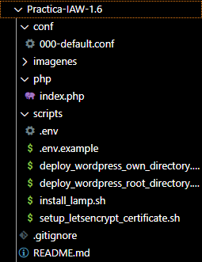

# Practica-IAW-1.6- Instalación de WordPress en una instancia EC2 de AWS

## Pasos previos a la instalación

**para la instalación vamos a tener que crear la siguiente estructura de directorios y archivos:**



**Una vez creados los archivos y directorios, procedemos a la instalación de las herramientas.**

## HTTPS con Let’s Encrypt y Certbot

## 1. Creamos un nombre de dominio para nuestro servidor con la web `no-ip`

### Paso 1. Crear el nombre del dominio 

Para crear el nombre de dominio en la página, tenemos que registrarnos y dirigirnos al sitio que muestra la captura y darle a **crear nombre de host**.


Una vez dado al recuadro de crear el nombre, nos sale un asistente para poner el nombre de host que queramos, el dominio que queremos que lleve, la dirección ip de la máquina o pc que queremos que tenga ese nombre de host y el tipo de registro que queremos que lleve, en nuestro caso es el **DNS Host A**


Hecho esto ya podemos automatizar el proceso de obtener el certificado con Let's Encrypt

## 2. Creación del archivo `setup_letsencrypt_certificate` para la automatización de la creación del certificado SSL/TLS

### Paso 1. Importamos el archivo de variables y mostramos los comandos que se van ejecutando 

```
source .env
```

```
set -ex
```

### Paso 2. Instalamos y actualizamos snap

```
snap install core
snap refresh core
```

### Paso 3. Eliminamos instalaciones previas de certbot con apt

```
apt remove certbot -y
```

### Paso 4. instalamos el cliente de certbot 

```
snap install --classic certbot
```

### Paso 5. Solicitamos un certificado a Let's Encrypt

```
certbot --apache -m $LE_EMAIL --agree-tos --no-eff-email -d $LE_DOMAIN --non-interactive
```

> [!IMPORTANT]  
> El certificado se lo pedimos así porque si ponemos ese comando en una terminal pide varias cosas y para que sea automatizado le pasamos todas las variables que pide y aparte, le pasamos nosotros dos variables que tenemos que crear en el archivo `.env` indicándole el email y el nombre de dominio creado de la página web `no-ip`.

### Paso 6. Deshabilitamos el host anterior y reiniciamos el servicio de apache

```
a2dissite 000-default.conf
```

```
systemctl reload apache2
```

> [!IMPORTANT]  
> Esto lo hacemos ya que al hacer el certificado con cerbot y Let's Encrypt, crea un archivo nuevo de configuración llamado `000-default-le-ssl.conf` que tiene el certificado y el puerto configurado para que rediriga al 443 en vez de al 80.

### Paso 7. Habilitamos el host nuevo y reiniciamos el servicio de apache

```
a2ensite 000-default-le-ssl.conf
```

```
systemctl reload apache2
```

### Paso 8. Hacemos que el host nuevo lea primero los archivos php antes que los de html

> [!IMPORTANT]  
> Hay que hacer esto ya que al entrar a la web, nos saldrá la página por defecto de apache y no queremos que pase eso ya que tenemos creado un `index.php` para que al entrar, aparezca esa página en vez de la de apache, así que con `nano` modificamos el archivo `000-default-le-ssl.conf` y le añadimos la línea `    DirectoryIndex index.php index.html`. Debe de quedar el archivo como en la siguiente imagen:


Una vez hecho esto, ya podemos acceder a la web y comprobar que entra correctamente con https en vez de http, y que si intentamos poner http redirige sólo al https.


Y si miramos el certificado de la página, aparece que está hecho con Let's Encrypt y el nombre del dominio y datos que le pusimos a la hora de crear el directorio.


