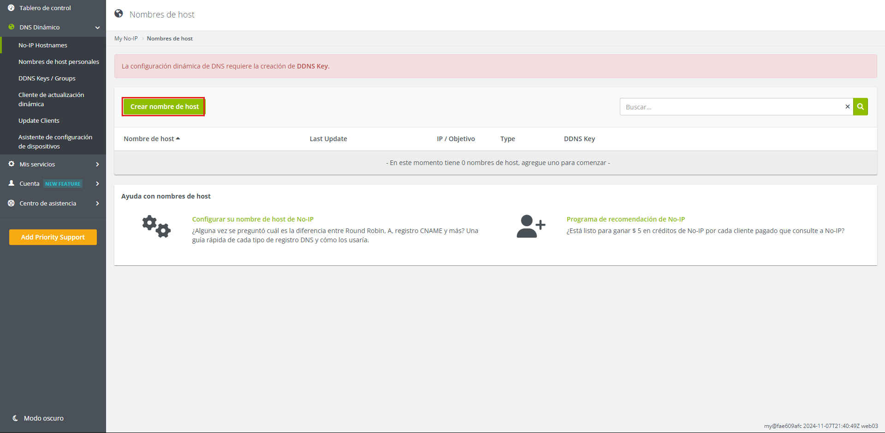
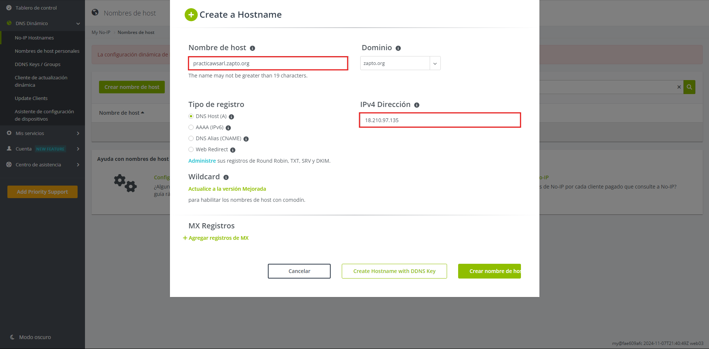
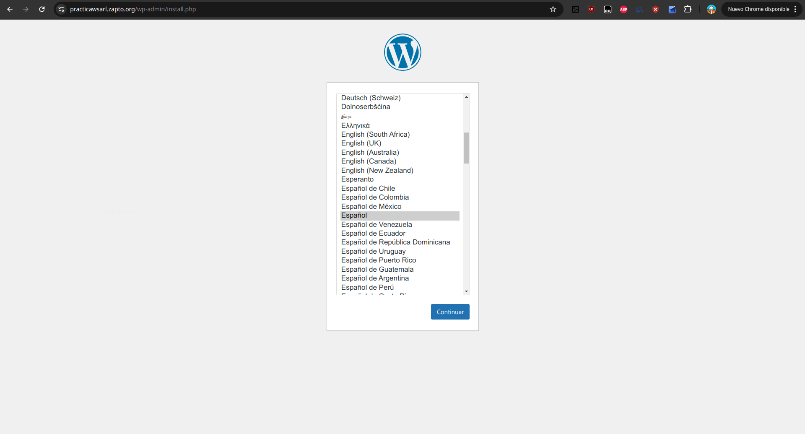
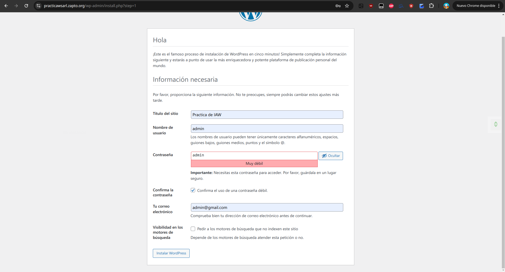
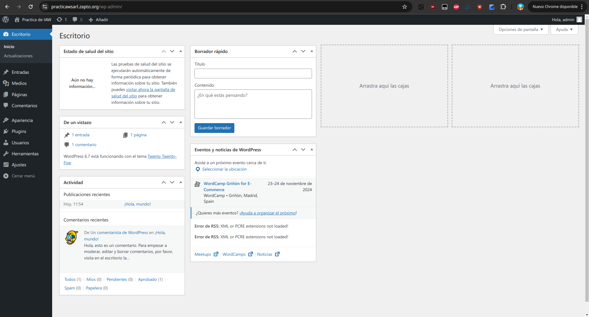

# Practica-IAW-1.6- Instalación de WordPress en una instancia EC2 de AWS

## Pasos previos a la instalación

**para la instalación vamos a tener que crear la siguiente estructura de directorios y archivos:**


**Una vez creados los archivos y directorios, procedemos a la instalación de las herramientas.**

## Instalación de WordPress en una instancia EC2 de AWS

## 1. Creamos un nombre de dominio para nuestro servidor con la web `no-ip`

### Paso 1. Crear el nombre del dominio 

Para crear el nombre de dominio en la página, tenemos que registrarnos y dirigirnos al sitio que muestra la captura y darle a **crear nombre de host**.



Una vez dado al recuadro de crear el nombre, nos sale un asistente para poner el nombre de host que queramos, el dominio que queremos que lleve, la dirección ip de la máquina o pc que queremos que tenga ese nombre de host y el tipo de registro que queremos que lleve, en nuestro caso es el **DNS Host A**



Hecho esto ya podemos automatizar el proceso de obtener el certificado con Let's Encrypt

## 2. Creación del archivo `deploy_wordpress_root_directory` para la instalación en la raíz

### Paso 1. Importamos el archivo de variables y mostramos los comandos que se van ejecutando 

```
source .env
```

```
set -ex
```

### Paso 2. Eliminamos descargas previas del codigo fuente de WordPress

```
rm -rf /tmp/latest.tar.gz
```

### Paso 3. Descargamos el codigo fuente de WordPress

```
wget https://wordpress.org/latest.tar.gz -P /tmp
```

> [!TIP]  
> Hacemos esto para evitar que haya duplicados dentro de ese directorio a la hora de descargarnos el codigo fuente de WordPress.

### Paso 4. Descomprimimos el codigo fuente de WordPress

```
tar -xzvf /tmp/latest.tar.gz -C /tmp
```

> [!NOTE]  
> Utilizamos los siguientes parámetros:
> 
> * `-x`: Indica que deseamos extraer el contenido del archivo.
>
> * `-z`: Señala que queremos descomprimir el archivo.
>
> * `-v`: Activa el modo detallado para mostrar en pantalla el proceso de descompresión.
>
> * `-f`: Se usa para especificar el nombre del archivo de entrada.
>
> * `-C`: Se utiliza para definir el directorio de destino.


### Paso 5. Eliminamos el contenido de instalaciones previas en /var/www/html

```
rm -rf /var/www/html/*
```

### Paso 6. Movemos el código fuente de WordPress a /var/www/html

```
mv -f /tmp/wordpress/* /var/www/html
```

### Paso 7. Creamos la base de datos y el usuario para WordPress

```
mysql -u root <<< "DROP DATABASE IF EXISTS $WORDPRESS_DB_NAME"
mysql -u root <<< "CREATE DATABASE $WORDPRESS_DB_NAME"
mysql -u root <<< "DROP USER IF EXISTS $WORDPRESS_DB_USER@$IP_CLIENTE_MYSQL"
mysql -u root <<< "CREATE USER $WORDPRESS_DB_USER@$IP_CLIENTE_MYSQL IDENTIFIED BY '$WORDPRESS_DB_PASSWORD'"
mysql -u root <<< "GRANT ALL PRIVILEGES ON $WORDPRESS_DB_NAME.* TO $WORDPRESS_DB_USER@$IP_CLIENTE_MYSQL"
```

> [!IMPORTANT]  
> Las variables las cambiamos por las que tenemos en el archivo `.env` configuradas para que se cree todo correctamente.

### Paso 8. Creamos el archivo de configuracion de WordPress

```
cp /var/www/html/wp-config-sample.php /var/www/html/wp-config.php
```

### Paso 9. Configuramos el archivo de configuracion de WordPress

```
sed -i "s/database_name_here/$WORDPRESS_DB_NAME/" /var/www/html/wp-config.php
sed -i "s/username_here/$WORDPRESS_DB_USER/" /var/www/html/wp-config.php
sed -i "s/password_here/$WORDPRESS_DB_PASSWORD/" /var/www/html/wp-config.php
sed -i "s/localhost/$WORDPRESS_DB_HOST/" /var/www/html/wp-config.php
```

> [!IMPORTANT]  
> Este archivo lo modificamos ya que el original tiene unas variables que no tenemos y que si dejamos el archivo tal cual como viene pues no funcionaría. Así que, con el comando `sed -i` lo cambiamos con nuestras variables que tenemos en el archivo `.env`.

### Paso 10. Cambiamos el propietario y el grupo al directorio /var/www/html/

```
chown -R www-data:www-data /var/www/html/
```

### Paso 11. Comprobación de que funciona WordPress







----
## 3. Creación del archivo `deploy_wordpress_own_directory` para la instalación en la raíz

### Paso 1. Importamos el archivo de variables y mostramos los comandos que se van ejecutando 

```
source .env
```

```
set -ex
```

### Paso 2. Eliminamos descargas previas del codigo fuente de WordPress

```
rm -rf /tmp/latest.tar.gz
```

### Paso 3. Descargamos el codigo fuente de WordPress

```
wget https://wordpress.org/latest.tar.gz -P /tmp
```

### Paso 4. Descomprimimos el codigo fuente de WordPress

```
tar -xzvf /tmp/latest.tar.gz -C /tmp
```

### Paso 5. Eliminamos el contenido de instalaciones previas en /var/www/html

```
rm -rf /var/www/html/*
```

### Paso 6. Creamos el directorio para la instalación de WordPress

```
mkdir -p /var/www/html/$WORDPRESS_DIRECTORY
```

> [!IMPORTANT]  
> Las variables que irán apareciendo durante los pasos están todas definidas en el archivo `.env` y en `.env.example` se pueden ver las variables que hay que tener definidas.